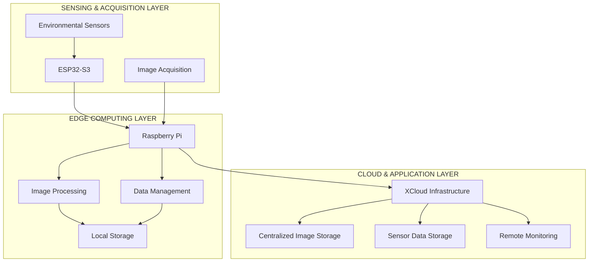
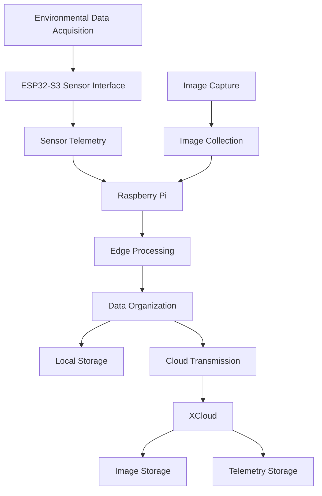

# MAIZE 
### Full-Stack IoT Environmental Monitoring & Data Acquisition Platform

MAIZE is a full-stack IoT environmental monitoring platform designed to integrate distributed sensor nodes, edge computing, image processing, and cloud infrastructure into a unified data acquisition and monitoring ecosystem.

The platform combines **ESP32-S3-based sensor acquisition, Raspberry Pi-based edge processing, automated image collection, and cloud-based data storage** to enable continuous environmental data collection, processing, and remote accessibility.

---

## Project Overview

MAIZE is designed around a distributed IoT architecture where multiple hardware and software components work together to collect, process, transmit, and store environmental data.

The platform focuses on:

- **Environmental Sensing:** Acquiring environmental parameters through distributed sensor interfaces.
- **Image Acquisition:** Automated image capture for visual monitoring and data collection.
- **Edge Computing:** Raspberry Pi-based processing and management of collected data.
- **Image Processing:** Processing and organizing captured images for further analysis.
- **Data Management:** Coordinated collection and storage of sensor telemetry and image datasets.
- **Cloud Integration:** Transferring and storing collected information through XCloud infrastructure.
- **Remote Monitoring:** Enabling centralized access to collected environmental information.

---

## System Architecture

MAIZE follows a distributed architecture consisting of three primary layers.



### 1. Sensing & Acquisition Layer

Responsible for acquiring environmental parameters and visual data.

**Hardware:**
- ESP32-S3 microcontroller.
- Environmental sensors.
- Image acquisition hardware.

**Responsibilities:**
- Sensor initialization and interfacing.
- Periodic environmental data acquisition.
- Sensor telemetry generation.
- Image acquisition and collection.

### 2. Edge Computing Layer

The Raspberry Pi acts as the edge computing and data management platform.

**Hardware:**
- Raspberry Pi.

**Responsibilities:**
- Receiving and managing acquired data.
- Image processing and organization.
- Local image and telemetry management.
- Coordinating data collection.
- Preparing datasets for cloud transmission.

### 3. Cloud & Application Layer

The cloud layer provides centralized data storage and remote accessibility.

**Infrastructure:**
- XCloud infrastructure.

**Responsibilities:**
- Centralized image storage.
- Environmental telemetry storage.
- Data accessibility and management.
- Supporting remote monitoring and future analytics.

---

## 🔄 Data Acquisition Pipeline

The MAIZE data pipeline follows a structured acquisition and storage workflow.



The pipeline is designed to maintain two primary data streams:

| Data Stream | Source | Processing | Destination |
|---|---|---|---|
| Sensor Telemetry | ESP32-S3 | Edge data management | Cloud storage |
| Image Data | Image acquisition hardware | Raspberry Pi image processing | Cloud storage |

---

## 🛠️ Technology Stack

| Category | Technologies |
|---|---|
| Microcontroller | ESP32-S3 |
| Edge Computing | Raspberry Pi |
| Firmware Development | ESP-IDF |
| Programming Languages | C, C++, Python |
| Image Processing | OpenCV |
| Operating System | Linux |
| Cloud Infrastructure | XCloud |
| Version Control | Git, GitHub |

---

## Hardware Components

The platform integrates multiple hardware components for distributed data acquisition.

| Component | Purpose |
|---|---|
| ESP32-S3 | Sensor acquisition and embedded control |
| Raspberry Pi | Edge computing and data management |
| Environmental Sensors | Environmental parameter measurement |
| Camera / Image Acquisition Hardware | Visual data collection |
| Storage | Local image and telemetry storage |

*The hardware configuration can be extended depending on deployment requirements.*

---

## Software Architecture

The software is organized around independent functional components.

### Embedded Firmware
- Sensor interfacing and initialization.
- Periodic data acquisition.
- Telemetry generation.
- Communication with the edge platform.

### Edge Processing
- Data reception and management.
- Image processing using OpenCV.
- Local data organization.
- Cloud data synchronization.

### Cloud Integration
- Image upload and storage.
- Sensor telemetry storage.
- Centralized data management.
- Remote data accessibility.

---

## Repository Structure

The repository is organized around the different subsystems of the MAIZE platform.

```text
MAIZE/
│
├── firmware/           # ESP32-S3 firmware
│
├── raspberry_pi/       # Raspberry Pi software
│   ├── image_processing/
│   ├── data_collection/
│   └── storage/
│
├── cloud/              # Cloud integration
│
├── docs/               # Documentation and architecture
│
├── README.md
└── .gitignore
```

*Directory names are indicative; adapt them to the actual repository structure.*

---

## Development & Deployment

### ESP32-S3 Firmware

The embedded firmware is developed using ESP-IDF.

1. Install ESP-IDF and configure the development environment.
2. Navigate to the firmware directory.
3. Configure the target ESP32-S3.
4. Build and flash the firmware.

```bash
idf.py set-target esp32s3
idf.py build
idf.py flash monitor
```

### Raspberry Pi

The edge computing platform runs on Linux.

Typical setup:

```bash
sudo apt update
sudo apt upgrade
```

Install Python dependencies as required by the project:

```bash
pip install -r requirements.txt
```

---

## Project Objectives

MAIZE aims to establish a scalable and modular IoT infrastructure capable of:

- Integrating embedded sensor networks with edge computing.
- Combining environmental telemetry with visual data acquisition.
- Supporting automated and periodic data collection.
- Processing images at the edge.
- Maintaining organized local datasets.
- Synchronizing collected data with cloud infrastructure.
- Providing a foundation for future environmental analytics and intelligent monitoring.

---

## Future Scope

Potential extensions to the platform include:

- Advanced computer vision and image analytics.
- Real-time environmental monitoring dashboards.
- Automated anomaly detection.
- Edge-based machine learning.
- Distributed sensor node expansion.
- Improved cloud synchronization and data management.
- Long-term environmental trend analysis.

---

## Development

**Project:** MAIZE  
**Repository:** [SamarthNN/MAIZE](https://github.com/SamarthNN/MAIZE)

Developed as a modular IoT platform integrating embedded systems, edge computing, image processing, and cloud technologies.

---

## License

License information will be added separately.
